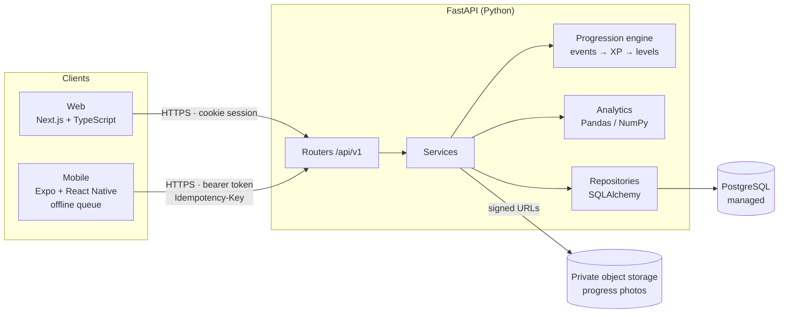

# LIFEOS architecture

A one-page map. Details live in `docs/`:

| Topic | Document |
|---|---|
| Technical decisions, components, environments | [docs/architecture.md](docs/architecture.md) |
| Database: ERD, tables, constraints, indexes | [docs/database.md](docs/database.md) |
| API: conventions and endpoint map | [docs/api-contracts.md](docs/api-contracts.md) · [docs/api/openapi.yaml](docs/api/openapi.yaml) |
| XP, levels, form, attributes, analytics methods | [docs/progression-rules.md](docs/progression-rules.md) |
| Authentication, privacy, offline sync | [docs/security-and-sync.md](docs/security-and-sync.md) |
| Visual design and screens | [docs/ui-design-system.md](docs/ui-design-system.md) |
| Status and next steps | [PROGRESS.md](PROGRESS.md) |

## System at a glance

## Rules that shape everything

1. **One source of truth.** Web and mobile read and write the same API and database. Neither keeps its own business logic.
2. **The backend owns progression.** Clients never send XP, levels or attribute scores. They send activity, and the server derives the rest from versioned rules.
3. **Every write is idempotent.** Mutations carry an `Idempotency-Key`, so retries and offline replays happen exactly once.
4. **No silent overwrites.** Editable records carry a `version`; a stale update gets `409 Conflict` with the server copy.
5. **Lifetime XP only goes up.** Rule changes apply going forward. Corrections are separate, visible ledger entries.
6. **Personal-first.** One owner, no public signup. `user_id` ownership is enforced on every query anyway.
7. **No paid AI.** All intelligence is deterministic Python: rules, rolling windows, statistics.
