# Database design (Phase 1)

> Status: **proposed for owner review.** This is the target for the first Alembic migrations in Phase 2. Tables beyond the spec's initial list (§6) are marked **(added)**, each with the screen that needs it.

PostgreSQL 16. Extensions: `pgcrypto` (UUIDs) and `citext` (username).

## 1. Conventions

**Standard columns**: every owned, synced table has these (written `…std` below).

| Column | Type | Notes |
|---|---|---|
| `id` | `uuid` PK | Client-generated for offline-creatable tables (D1), otherwise `gen_random_uuid()` |
| `user_id` | `uuid` NOT NULL → `users.id` ON DELETE CASCADE | Every repository query filters on it |
| `created_at` / `updated_at` | `timestamptz` NOT NULL default `now()` | UTC; `updated_at` maintained by trigger |
| `version` | `int` NOT NULL default 1 | Bumped on every update; checked with `If-Match` (D3) |
| `deleted_at` | `timestamptz` NULL | Soft delete / tombstone (D4) |
| `change_seq` | `bigint` NOT NULL | `nextval('change_seq')` on insert/update via trigger; sync cursor |

**Index on every `…std` table:** `(user_id, change_seq)` for sync pulls. Partial indexes use `WHERE deleted_at IS NULL` for normal reads.

**Day-based rows** store `local_date date` computed in `users.timezone` at write time (D5).

**Checks:**
- Ratings are 1–5.
- Loads, durations and distances are ≥ 0, with a sane upper bound.
- Enums are Postgres `text` columns with a `CHECK (… IN (…))` list, which is easier to migrate than native enums.

**Money, nutrition, calories:** none, by design.

## 2. ERD (core relationships)

```mermaid
erDiagram
  users ||--o{ refresh_tokens : has
  users ||--o{ subjects : has
  subjects ||--o{ study_sessions : "studied in"
  subjects ||--o{ assignments : has
  users ||--o{ coding_sessions : has
  coding_sessions ||--o{ dsa_problems : "solved in"
  users ||--o{ learning_milestones : has
  users ||--o{ coding_milestones : has
  users ||--o{ semesters : has
  users ||--o{ workout_sessions : has
  workout_templates ||--o{ workout_sessions : "based on"
  workout_sessions ||--o{ exercise_sets : contains
  exercises ||--o{ exercise_sets : "performed as"
  users ||--o{ body_measurements : has
  users ||--o{ progress_photos : has
  users ||--o{ cardio_sessions : has
  users ||--o{ daily_logs : "one per day"
  users ||--o{ health_records : has
  users ||--o{ tasks : has
  habits ||--o{ habit_logs : "one per day"
  users ||--o{ screen_time_records : has
  users ||--o{ activity_events : emits
  activity_events ||--o{ xp_transactions : awards
  xp_rules ||--o{ xp_transactions : "applied by"
  skill_profiles ||--o{ xp_transactions : credits
  users ||--o{ attribute_snapshots : has
  goals ||--o{ goal_milestones : has
  goals ||--o{ goal_progress : tracks
  users ||--o{ quests : has
  achievements ||--o{ achievement_unlocks : unlocked
  users ||--o{ idempotency_keys : has
```

## 3. Tables

### Identity and settings

**users** (one row in practice; no public signup)

| Column | Type | Notes |
|---|---|---|
| id | uuid PK | |
| username | citext UNIQUE NOT NULL | |
| password_hash | text NOT NULL | Argon2id |
| display_name | text | |
| timezone | text NOT NULL default `'UTC'` | IANA name, validated |
| week_start | smallint NOT NULL default 1 CHECK = 1 | Monday (approved) |
| created_at, updated_at | timestamptz | |

**refresh_tokens**: token rotation with reuse detection (see security doc).

| Column | Type | Notes |
|---|---|---|
| id | uuid PK | |
| user_id | uuid FK | |
| family_id | uuid NOT NULL | All rotations of one login share it |
| token_hash | bytea UNIQUE NOT NULL | SHA-256 of the opaque token; the raw token is never stored |
| client | text CHECK IN (`web`,`mobile`) | |
| expires_at, created_at | timestamptz | |
| used_at, revoked_at | timestamptz NULL | Reusing a used token revokes the whole family |

Index: `(user_id, family_id)`.

**personal_targets (added).** Attribute targets set in Settings; replaces the preview's placeholder targets.

| Column | Type | Notes |
|---|---|---|
| …std | | |
| key | text NOT NULL | e.g. `lift.bench.e1rm_kg`, `sleep.hours`, `steps.daily`, `run.speed_kmh`, `run.weekly_km`, `study.focus_h_per_day`, `learning.milestones_90d`, `dsa.weighted_28d` |
| value | numeric NOT NULL CHECK > 0 | |

Unique: `(user_id, key) WHERE deleted_at IS NULL`.

**user_settings (added).** One row per user.

| Column | Type | Notes |
|---|---|---|
| user_id | uuid PK FK | |
| reminders | jsonb NOT NULL default `'{}'` | e.g. `{"checkin":"09:00"}`; validated by schema |
| updated_at, version | | |

### Academics

**subjects**: `…std`, `name text NOT NULL`, `short_name text NOT NULL`, `credits smallint CHECK 0–30`, `units_total smallint CHECK ≥ 0`, `units_done smallint CHECK 0–units_total`, `semester_id uuid NULL → semesters`, `archived bool default false`.
Unique: `(user_id, short_name) WHERE deleted_at IS NULL AND NOT archived`.

**study_sessions** (offline-creatable)

| Column | Type | Notes |
|---|---|---|
| …std | | |
| subject_id | uuid NULL → subjects | |
| started_at | timestamptz NOT NULL | |
| minutes | int NOT NULL CHECK 1–600 | Focused minutes |
| planned_minutes | int NULL CHECK 1–600 | Enables the "finished as planned" Discipline signal |
| focus_rating | smallint NULL CHECK 1–5 | |
| local_date | date NOT NULL | |
| note | text NULL CHECK length ≤ 2000 | |

Index: `(user_id, local_date)`.

**coding_sessions** (offline-creatable): same shape as study_sessions, with `area text CHECK IN ('dsa','project','course','other')` in place of subject_id.

**dsa_problems (added).** Outcome evidence for DSA (Academics → DSA progress).

| Column | Type | Notes |
|---|---|---|
| …std | | |
| coding_session_id | uuid NULL → coding_sessions | |
| solved_at | timestamptz NOT NULL | |
| local_date | date NOT NULL | |
| difficulty | text CHECK IN (`easy`,`medium`,`hard`) | |
| topic | text NOT NULL | Free text with suggestions |
| title | text NULL | |
| url | text NULL | |

Unique: `(user_id, url) WHERE url IS NOT NULL AND deleted_at IS NULL`, so the same problem can't be farmed for XP.

**coding_milestones**: `…std`, `project text NOT NULL`, `title text NOT NULL`, `skill_key text NOT NULL default 'backend_development'`, `planned_for date NULL`, `completed_at timestamptz NULL`, `evidence_url text NULL`.

**learning_milestones (added):** learning milestones and assessment results (Academics → Milestones; Intelligence signal).

| Column | Type | Notes |
|---|---|---|
| …std | | |
| subject_id | uuid NULL → subjects | |
| kind | text CHECK IN (`learning`,`assessment`) | |
| title | text NOT NULL | |
| planned_for | date NULL | |
| completed_at | timestamptz NULL | |
| score | numeric NULL | |
| max_score | numeric NULL | CHECK `score <= max_score`; both or neither |

**assignments**: `…std`, `subject_id → subjects`, `title text NOT NULL`, `due_at timestamptz NOT NULL`, `status text CHECK IN ('not_started','in_progress','submitted','graded')`, `grade_score numeric NULL`, `grade_max numeric NULL`.
Index: `(user_id, due_at) WHERE deleted_at IS NULL`.

**semesters (added)** (Academics → Semester record): `…std`, `label text NOT NULL`, `ordinal smallint NOT NULL`, `credits smallint`, `sgpa numeric(4,2) NULL CHECK 0–10`, `is_current bool`.
Unique: `(user_id, ordinal)`. CGPA is computed, not stored.

### Fitness

**exercises** (library): `…std`, `name text NOT NULL`, `muscle_group text CHECK IN ('chest','back','legs','shoulders','arms','core','full_body')`, `equipment text`, `tracked_lift text NULL CHECK IN ('bench','squat','deadlift','ohp')`.
Unique: `(user_id, lower(name)) WHERE deleted_at IS NULL`.

**workout_templates (added).** Splits (Push / Pull / Legs).
- `workout_templates`: `…std`, `name text NOT NULL`.
- `workout_template_exercises`: `template_id uuid → workout_templates ON DELETE CASCADE`, `exercise_id → exercises`, `position smallint`, `target_sets smallint`, `target_reps smallint`. PK `(template_id, position)`.

**training_plans (added).** Weekday schedule plus rotation (the mobile "next in rotation" suggestion).
- Columns: `…std`, `weekdays smallint[] NOT NULL` (1 = Mon … 7 = Sun), `rotation uuid[] NOT NULL` (template ids in order), `active bool`.
- Only one active plan: unique `(user_id) WHERE active AND deleted_at IS NULL`.

**workout_sessions** (offline-creatable)

| Column | Type | Notes |
|---|---|---|
| …std | | |
| template_id | uuid NULL → workout_templates | |
| started_at | timestamptz NOT NULL | |
| ended_at | timestamptz NULL | CHECK `ended_at >= started_at` |
| local_date | date NOT NULL | |
| note | text NULL | |

**exercise_sets** (offline-creatable)

| Column | Type | Notes |
|---|---|---|
| …std | | |
| workout_session_id | uuid NOT NULL → workout_sessions ON DELETE CASCADE | |
| exercise_id | uuid NOT NULL → exercises | |
| position | smallint NOT NULL | |
| load_kg | numeric(6,2) NOT NULL CHECK 0–600 | |
| reps | smallint NOT NULL CHECK 1–100 | |
| rpe | numeric(3,1) NULL CHECK 5–10 | Optional |
| is_warmup | bool default false | |
| is_top_set | bool default false | |

Unique: `(workout_session_id, position)`. Est. 1RM is computed (Epley, 1–10 reps), not stored.

**body_measurements**: `…std`, `measured_on date NOT NULL`, `weight_kg numeric(5,2) NULL CHECK 20–400`, `waist_cm numeric(5,1) NULL CHECK 30–250`, CHECK at least one present.

**progress_photos**
- Columns: `…std`, `taken_on date NOT NULL`, `object_key text NOT NULL UNIQUE`, `content_type text CHECK IN ('image/jpeg','image/png','image/heic')`, `bytes int CHECK ≤ 15 MB`, `upload_state text CHECK IN ('pending','stored')`.
- Never a public URL; reads use signed URLs.

**cardio_sessions (added)** (runs; Endurance signals): `…std`, `kind text CHECK IN ('run','walk','cycle','other')`, `started_at`, `local_date`, `distance_km numeric(6,2) CHECK 0–300`, `duration_s int CHECK 1–86400`, `source text CHECK IN ('manual','import')`.

### Health and recovery

**daily_logs**: the daily check-in, one per local day (offline-creatable, upserted by date).

| Column | Type | Notes |
|---|---|---|
| …std | | |
| local_date | date NOT NULL | Unique `(user_id, local_date) WHERE deleted_at IS NULL` |
| sleep_hours | numeric(4,2) NULL CHECK 0–16 | Night before `local_date` |
| sleep_quality | smallint NULL CHECK 1–5 | |
| energy | smallint NULL CHECK 1–5 | |
| recovery | smallint NULL CHECK 1–5 | |
| mood | smallint NULL CHECK 1–5 | |

Readiness is computed, not stored.

**health_records.** Metric samples entered manually or imported.

| Column | Type | Notes |
|---|---|---|
| …std | | |
| metric | text CHECK IN (`steps`,`resting_hr`,`hydration_l`) | |
| local_date | date NOT NULL | |
| value | numeric NOT NULL | Bounds per metric: steps 0–100 000; resting_hr 25–220; hydration_l 0–15 |
| source | text CHECK IN (`manual`,`import`) | |
| source_ref | text NULL | Import dedupe key |

Unique: `(user_id, metric, local_date, source)`.

### Productivity

**tasks** (offline-creatable)

| Column | Type | Notes |
|---|---|---|
| …std | | |
| title | text NOT NULL CHECK length 1–200 | |
| notes | text NULL | |
| module | text CHECK IN (`academics`,`fitness`,`health`,`productivity`,`skills`,`goals`) NULL | |
| priority | text CHECK IN (`high`,`normal`,`low`) default `normal` | |
| planned_for | date NULL | Counts toward that day's plan (consistency) |
| due_at | timestamptz NULL | |
| completed_at | timestamptz NULL | |
| assignment_id | uuid NULL → assignments | |

Index: `(user_id, planned_for) WHERE deleted_at IS NULL`.

**habits**: `…std`, `name text NOT NULL`, `schedule smallint[] NOT NULL default '{1,2,3,4,5,6,7}'`, `active bool`.

**habit_logs**: `…std`, `habit_id uuid → habits ON DELETE CASCADE`, `local_date date NOT NULL`, `done bool NOT NULL`. Unique `(habit_id, local_date)`.

**screen_time_records (added)**: `…std`, `local_date date NOT NULL`, `minutes int CHECK 0–1440`, `source text CHECK IN ('manual','import')`. Unique `(user_id, local_date, source)`.

### Progression

**skill_profiles**: `…std`, `key text NOT NULL` (e.g. `programming`, `dsa`, `backend_development`, `learning`, `strength`, `endurance`, `discipline`, `consistency`, `recovery`), `name text`, `lifetime_xp bigint NOT NULL default 0 CHECK ≥ 0`, `level int NOT NULL default 1`.
Unique: `(user_id, key)`. `lifetime_xp` and `level` are caches; rebuildable from the ledger.

**activity_events.** Validated facts that can earn XP.

| Column | Type | Notes |
|---|---|---|
| id | uuid PK | |
| user_id | uuid FK | |
| type | text NOT NULL | e.g. `study_session.logged`, `coding_session.logged`, `dsa_problem.solved`, `workout.completed`, `lift.e1rm_pr`, `cardio.logged`, `day.on_plan`, `milestone.completed`, `assessment.recorded` |
| source_table | text NOT NULL | |
| source_id | uuid NOT NULL | |
| occurred_at | timestamptz NOT NULL | |
| local_date | date NOT NULL | |
| payload | jsonb NOT NULL | Validated snapshot used by rules |
| created_at | timestamptz | |

Unique: `(user_id, type, source_id)`. **The same fact can't produce two events.**

**xp_rules** (versioned configuration, spec §4.2)

| Column | Type | Notes |
|---|---|---|
| id | text | e.g. `study.focus_minutes` |
| version | int | PK `(id, version)` |
| event_type | text NOT NULL | |
| skill_key | text NOT NULL | |
| params | jsonb NOT NULL | e.g. `{"per_minutes":3,"session_cap":60,"daily_cap":180}` |
| valid_from | timestamptz NOT NULL | |
| valid_to | timestamptz NULL | Only one open version per id |
| description | text NOT NULL | Shown in the UI method popovers |

**xp_transactions** (append-only ledger)

| Column | Type | Notes |
|---|---|---|
| id | uuid PK | |
| user_id | uuid FK | |
| event_id | uuid NULL → activity_events | NULL only for `kind = 'correction'` |
| rule_id, rule_version | text, int → xp_rules | |
| skill_key | text NOT NULL | |
| amount | int NOT NULL | Positive for awards. Corrections may be negative but never take a skill total below 0 (checked in the service) |
| kind | text CHECK IN (`award`,`correction`) | |
| reason | text NOT NULL | Shown in XP history |
| cap_note | text NULL | e.g. "Session cap 60 XP applied" |
| created_at | timestamptz | |

Unique: `(event_id, rule_id) WHERE kind = 'award'` (**exactly once**). No UPDATE or DELETE grants for the app role on this table.

**performance_metrics.** Measured values behind form and attributes, written by services.
- Columns: `id`, `user_id`, `metric text` (e.g. `e1rm.bench`, `run.speed_kmh`), `local_date`, `value numeric`, `source_table`, `source_id`.
- Unique: `(user_id, metric, source_id)`.

**attribute_snapshots (added)**: `user_id`, `local_date`, `attribute text`, `score smallint NULL`, `coverage numeric(4,3)`, `signals jsonb`. PK `(user_id, local_date, attribute)`. Written nightly.

### Goals, quests, achievements

**goals**

| Column | Type | Notes |
|---|---|---|
| …std | | |
| title | text NOT NULL | |
| metric | text NOT NULL | Measured source, e.g. `e1rm.bench`, `subject.units_done:<id>`, `run.weekly_km` |
| start_value, target_value | numeric NOT NULL | CHECK `start <> target` |
| unit | text NOT NULL | |
| due_on | date NULL | |
| status | text CHECK IN (`active`,`completed`,`abandoned`) | |
| completed_at | timestamptz NULL | |

**goal_milestones (added)**: `…std`, `goal_id → goals ON DELETE CASCADE`, `label text`, `value numeric NOT NULL`, `reached_at timestamptz NULL`. Unique `(goal_id, value)`.

**goal_progress**: `id`, `goal_id`, `user_id`, `local_date`, `value numeric`, `source_table`, `source_id`. Index `(goal_id, local_date)`.

**quests.** Daily objectives and weekly quests; accepted challenges become quests.

| Column | Type | Notes |
|---|---|---|
| …std | | |
| period | text CHECK IN (`day`,`week`) | |
| period_start | date NOT NULL | Monday for weekly |
| title | text NOT NULL | |
| metric | text NOT NULL | e.g. `workouts.count`, `study.hours`, `dsa.count`, `daily_log.count` |
| target | numeric NOT NULL CHECK > 0 | |
| origin | text CHECK IN (`manual`,`template`,`challenge`) | |
| challenge_basis | jsonb NULL | Inputs of the challenge rule, for "Why this?" |
| completed_at | timestamptz NULL | |

Index: `(user_id, period, period_start)`.

**achievements** (definitions; seeded, global)
- Columns: `key text PK`, `title`, `criteria text`, `rule jsonb`, `rule_version int`.
- Rules are measurable, e.g. `{"metric":"dsa.lifetime_count","gte":100}`.

**achievement_unlocks**: `user_id`, `achievement_key → achievements`, `unlocked_at timestamptz`, `evidence jsonb`. PK `(user_id, achievement_key)`.

**insight_dismissals (added)**: `user_id`, `insight_key text`, `dismissed_at`. PK `(user_id, insight_key)`.

### Infrastructure

**idempotency_keys** (D2)

| Column | Type | Notes |
|---|---|---|
| user_id | uuid | |
| key | text CHECK length 16–128 | |
| method, path | text | |
| request_hash | bytea | SHA-256 of the canonical body |
| status_code | smallint | |
| response_body | jsonb | |
| created_at | timestamptz | |

PK `(user_id, key)`. Rows are purged after 30 days.

**Sequence:** `change_seq` (global, bigint). **Trigger:** `set_change_seq_and_updated_at()` runs on all `…std` tables.

## 4. Deletes, retention, backups
- **Deletes:** user-facing deletes are soft (`deleted_at`). A nightly job hard-deletes tombstones older than 90 days, after every client cursor has passed them.
- **XP stays:** deleting a session does **not** delete its XP; it adds a `correction` transaction with reason "Entry deleted", so the ledger stays auditable. Owner decision on this policy: see the progression rules §11.
- **Backups:** managed point-in-time recovery, plus a nightly logical dump to separate storage, kept 30 days. A restore drill runs once per phase.
- **Export:** a ZIP of JSON per table, plus photos on request (see API `/export`).

## 5. Indexing summary
- Every `…std` table: `(user_id, change_seq)`.
- Date reads: `(user_id, local_date)` on sessions, sets (via session), daily_logs, health_records, habit_logs, screen_time, cardio.
- Ledger: `xp_transactions (user_id, created_at DESC)` and `(user_id, skill_key, created_at DESC)`.
- Unique dedupe constraints as listed per table. They are the database's half of exactly-once.
